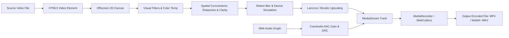

# 🎬 HandBrake Mobile & Web (VideoEncoder)

[](https://everlovingvijay.github.io/VideoEncoder/)
[](https://opensource.org/licenses/Apache-2.0)
[](https://react.dev/)
[](https://www.typescriptlang.org/)
[](https://tailwindcss.com/)
[](https://web.dev/progressive-web-apps/)

> **Professional High-Performance Universal Video Transcoding & Visual Enhancement Studio**  
> Bringing the full power, modular architecture, and tabbed workflow of **HandBrake Desktop** to mobile devices, tablets, and modern web browsers. Featuring real-time **hardware-accelerated encoding**, **15 advanced video enhancement controls**, **7 recording device quality simulation profiles**, **directional motion blur simulation**, **intelligent resolution upscaling (2x/4x/8x/4K)**, and **automated footage analysis with smart preset recommendations** — **100% client-side with zero server uploads**.

🌐 **Live Web Application**: [https://everlovingvijay.github.io/VideoEncoder/](https://everlovingvijay.github.io/VideoEncoder/)  
⚡ **Dedicated Studio Suite**: [https://everlovingvijay.github.io/VideoEncoder/studio.html](https://everlovingvijay.github.io/VideoEncoder/studio.html)

---

## 📑 Table of Contents

- [Key Upgrades & Architectural Highlights](#-key-upgrades--architectural-highlights)
- [1. Advanced Video Enhancement Controls](#1-advanced-video-enhancement-controls)
- [2. Recording Device Quality Simulation](#2-recording-device-quality-simulation)
- [3. Motion Blur & Shutter Speed Controls](#3-motion-blur--shutter-speed-controls)
- [4. Intelligent Resolution Upscaling](#4-intelligent-resolution-upscaling)
- [5. Intelligent Preset Recommendation Engine](#5-intelligent-preset-recommendation-engine)
- [6. Real-Time A/B Split Screen Comparison](#6-real-time-ab-split-screen-comparison)
- [7. HandBrake Desktop Tab Alignment](#7-handbrake-desktop-tab-alignment)
- [8. Hardware Acceleration & Transcoding Pipeline](#8-hardware-acceleration--transcoding-pipeline)
- [9. Universal Device Emulation & PWA Support](#9-universal-device-emulation--pwa-support)
- [10. Local Development & Deployment](#10-local-development--deployment)
- [Privacy & Security](#-privacy--security)
- [License](#-license)

---

## 🚀 Key Upgrades & Architectural Highlights

- **🔒 100% Client-Side Privacy**: All frame decoding, pixel-level color grading, spatial convolutions, audio muxing, and video compression execute directly inside your browser's local sandbox via WebCodecs, HTML5 Canvas 2D, and MediaRecorder.
- **🎛️ HandBrake Desktop 1.9.0 Interface**: Complete layout parity with the desktop application across 10 modular tabs: `Summary`, `Dimensions`, `Filters`, `Enhancement`, `Device Profile`, `Motion Blur`, `Video`, `Audio`, `Subtitles`, and `Chapters`.
- **⚡ Real-Time Visual Pipeline**: Changes to sliders immediately reflect in real-time on the video preview canvas and are baked directly into the final encoded output.
- **📱 Responsive Platform Switcher**: Test how your media renders across an **iPhone 16 Pro** (with Dynamic Island status), **Google Pixel 9 Pro**, **Mobile Web touch layout**, or **Desktop Widescreen Studio Suite**.
- **💻 Native Code Export**: Instant generation of copy-pasteable **Swift (AVFoundation / VideoToolbox)** and **Kotlin (Android MediaCodec / MediaMuxer)** production codebases.

---

## 1. Advanced Video Enhancement Controls

The **Enhancement** inspector provides 15 precision sliders, each equipped with an individual **Reset** button, alongside a **Reset All** action:

| Parameter | Range | Default | Description |
| :--- | :--- | :--- | :--- |
| **Sharpness** | `0 to 100` | `0` | 3×3 unsharp Laplacian convolution kernel to boost edge definition without over-sharpening halos. |
| **Noise Reduction** | `0 to 100` | `0` | Edge-preserving spatial-temporal bilateral smoothing to remove digital sensor noise. |
| **Film Grain** | `0 to 100` | `0` | Organic pseudo-random grain synthesis simulating authentic 35mm celluloid emulsion. |
| **Contrast** | `0 to 100` | `50` | Midtone tonal expansion with S-curve contrast roll-off. |
| **Brightness** | `0 to 100` | `50` | Baseline luminance offset. |
| **Saturation** | `0 to 200%` | `100%` | Chroma intensity scaling across all color channels. |
| **Gamma Correction** | `0.1 to 3.0` | `1.0` | Power-law gamma lookup curve ($V_{\text{out}} = V_{\text{in}}^{1/\gamma}$) for nonlinear shadow/highlight compensation. |
| **Exposure (EV)** | `-2.0 to +2.0` | `0.0` | Photographic stop exposure multiplier ($2^{\Delta\text{EV}}$) for dynamic lighting correction. |
| **Clarity** | `0 to 100` | `0` | Large-radius local contrast enhancement to reveal textures without affecting overall tonal balance. |
| **Detail Enhancement** | `0 to 100` | `0` | High-frequency detail recovery pass for intricate surfaces (foliage, fabric, hair). |
| **Color Temperature** | `2000K to 10000K` | `6500K` | Blackbody radiator Kelvin matrix transformation (2000K candle warmth $\to$ 6500K D65 daylight $\to$ 10000K blue sky). |
| **White Balance Mode** | `Auto / Manual` | `Auto` | Select between automatic scene color neutrality or manual Kelvin tuning. |
| **Highlights** | `-100 to +100` | `0` | Selective curve modification targeted exclusively at luminance $> 50\%$ to recover blown-out skies. |
| **Shadows** | `-100 to +100` | `0` | Selective curve modification targeted exclusively at luminance $< 50\%$ to lift crushed darks. |
| **Vibrance** | `0 to 200%` | `100%` | Perceptual saturation boost that selectively targets under-saturated tones while protecting natural skin tones. |

### 10 Additional Image Processing Modules

Users can toggle individual processing algorithms on and off:
1. **AI Algorithmic Denoising**: Bilateral edge-preserving noise suppression.
2. **Debanding**: Eliminates 8-bit color stepping and gradient contour artifacts.
3. **Dehazing**: Dark channel prior contrast restoration for atmospheric haze and smoke.
4. **Edge Enhancement**: High-pass contour boost for crisper architectural and geometric lines.
5. **Chroma Noise Reduction**: Filters out colored speckles in low-light shadows.
6. **Luma Noise Reduction**: Smooths high-ISO luminance grain while preserving edge sharpness.
7. **Color Correction**: Full Rec.709 color gamut normalization.
8. **Motion Blur Reduction**: Deconvolution sharpening on high-velocity frames.
9. **Film Grain Simulation**: Organic photochemical celluloid grain overlay.
10. **Artificial Sharpening**: High-contrast edge boost for low-resolution footage.

---

## 2. Recording Device Quality Simulation

Select from 7 visual profiles that simulate the optical and sensor characteristics of different recording hardware, complete with an **Intensity slider (0 to 100%)**:

- 📱 **Normal HD Recording**: Clean 1080p standard mobile / compact camera footage with balanced sharpness and standard dynamic range.
- 📉 **Low Class Mobile Recording**: Simulates entry-level budget smartphone footage with lower perceived sharpness, visible 8×8 block compression artifacts, moderate sensor noise, crushed dynamic range, and slight motion blur.
- 📲 **Standard Mobile Recording**: Typical mid-tier smartphone camera quality with standard digital sharpening and consumer tone curves.
- 🤖 **High Quality Android Recording**: Flagship Android camera profile with punchy saturation (+15%), strong local HDR micro-contrast, and vibrant colors.
- 🍏 **iPhone Quality**: Flagship Apple iPhone characteristics with natural organic sharpness, balanced skin-tone warmth, smooth highlight roll-off, and zero artificial sharpening halos.
- 📷 **Professional Camera**: DSLR and cinema camera emulation featuring soft organic micro-contrast, wide dynamic range, cinema log response, and transparent optical fidelity.
- 🎞️ **Cinematic Recording**: Kodak 2383-inspired film emulation with rich shadows, warm highlights, controlled highlight roll-off, and subtle 35mm grain.

---

## 3. Motion Blur & Shutter Speed Controls

Provides physical camera shutter angle simulation and directional motion vectors:

- **Enable / Disable Toggle**: Master switch for motion blur processing.
- **Intensity Slider (`0 to 100%`)**: Adjusts blur vector length and frame accumulation weight.
- **Directional Vectors**:
  - `Natural Flow`: Organic 2D camera panning trajectory.
  - `Horizontal Pan`: High-speed lateral tracking blur.
  - `Vertical Tilt`: Vertical panning motion blur.
  - `Radial Zoom`: Kinetic zoom blur originating from the frame center.
- **Shutter Speed Simulation (180° Rule)**:
  - `1/24s`: Slow shutter dreamlike motion blur.
  - `1/30s`: Broadcast motion blur standard.
  - `1/60s`: Standard 180° shutter angle for 30 fps playback.
  - `1/120s`: Fast shutter crisp action sports.
  - `1/240s`: Ultra-fast mechanical shutter freeze.
- **Advanced Options**: Motion Blur Reduction, Frame Interpolation, and Optical Flow vector tracking.

---

## 4. Intelligent Resolution Upscaling

Automatically detects source dimensions and aspect ratio, calculating mathematically correct output resolutions:

### 📱 Portrait Video Presets (9:16 Aspect Ratio)
- **Original**: Maintains source resolution.
- **2x Upscale**: Doubles width and height.
- **4x Upscale**: Quadruples width and height.
- **8x Upscale**: 8× scaling for extreme resolution displays.
- **1080p Portrait**: `1080 × 1920` (Optimized for Instagram Reels, TikTok, Shorts).
- **2K Portrait**: `1440 × 2560`.
- **4K Portrait**: `2160 × 3840`.

### 🖥️ Landscape Video Presets (16:9 Aspect Ratio)
- **Original**: Maintains source resolution.
- **2x Upscale**: Doubles width and height.
- **4x Upscale**: Quadruples width and height.
- **8x Upscale**: 8× scaling.
- **1080p Landscape**: `1920 × 1080` (Full HD).
- **2K Landscape**: `2560 × 1440` (QHD).
- **4K Landscape**: `3840 × 2160` (Ultra HD).

### Scaling Algorithms Supported:
- **Lanczos-3**: Sinc-based sinc interpolation for maximum sharpness and detail retention.
- **Bicubic**: Smooth cubic interpolation balancing speed and visual anti-aliasing.
- **Bilinear**: Ultra-fast linear interpolation for resource-constrained devices.

---

## 5. Intelligent Preset Recommendation Engine

Upon loading any video, the **Footage Analyzer** automatically inspects:
- Pixel dimensions, storage size, and display aspect ratio.
- Orientation (`portrait 9:16`, `landscape 16:9`, `square 1:1`).
- Native framerate ($24, 30, 60\text{ fps}$) and container bitrate.
- Compression artifact severity and noise estimation.
- Dynamic range and sharpness score ($0 \to 100$).

### Built-in Intelligent Presets:
1. **Low Quality Footage Recovery**: For compressed, noisy, low-resolution clips. Applies deblocking, bilateral denoising, detail enhancement, and 2x Lanczos upscaling.
2. **Mobile Video Enhancement**: For everyday phone footage. Applies natural sharpening, balanced contrast, and color vibrance.
3. **iPhone Style Enhancement**: Simulates the warm, natural, halo-free iPhone camera pipeline.
4. **Professional Quality Enhancement**: For high-bitrate DSLR / mirrorless clips. Preserves wide dynamic range and applies 10-bit color grading.
5. **Cinematic Enhancement**: Kodak 2383-inspired film curve, 24 fps cadence, and subtle organic grain.
6. **Social Media Optimized**: Vertical 9:16 ($1080 \times 1920$) high-bitrate encoding tailored for Instagram Reels, YouTube Shorts, and TikTok.

---

## 6. Real-Time A/B Split Screen Comparison

- **Interactive Comparison Scrubber**: Drag the vertical divider line horizontally across the preview canvas to inspect the original unfiltered source on the left versus the enhanced footage on the right.
- **Live Filter Feedback**: Sliders update the preview canvas in real time before encoding begins.
- **Post-Encode Comparison**: Once a job is completed, the split scrubber directly compares the original source against the final compressed output file.

---

## 7. HandBrake Desktop Tab Alignment

| Tab | Key Controls & Settings |
| :--- | :--- |
| **Summary** | Container format (`MP4`, `MKV`, `WebM`, `MOV`), Metadata passthru, Video/Audio/Dimension summaries, SMPTE Rec.709 color bars test pattern. |
| **Dimensions** | Source dimensions, storage size, display size, rotation (0°, 90°, 180°, 270°), horizontal flip, pixel cropping margins (top, bottom, left, right), and intelligent upscaling options. |
| **Filters** | Deinterlace (`off`, `decomb`, `yadif`), Denoise (`hqdn3d`, `nlmeans`), Unsharp mask sharpen, Grayscale monochrome toggle. |
| **Enhancement** | 15 precision sliders with individual reset buttons, reset all, and 10 image processing toggles. |
| **Device Profile** | 7 recording device visual simulation profiles with intensity slider (0 to 100%). |
| **Motion Blur** | Direction vectors, 180° shutter speeds ($1/24\text{s} \to 1/240\text{s}$), blur reduction, frame interpolation. |
| **Video** | Codecs (`H.265 10-bit`, `H.264`, `AV1`, `ProRes 422`, `VP9`), Framerate (VFR vs CFR), Constant Quality (RF 0-51) vs Average Bitrate, 2-Pass encoding, Speed Preset slider (`ultrafast` to `slow`), Profile (`baseline`, `main`, `high`), Color space (`bt709`, `bt2020_hdr`). |
| **Audio** | Multi-track audio muxing, Codecs (`AAC CoreAudio`, `AC3`, `Opus`, `MP3`, `Passthru`), Bitrate ($128 \to 320\text{ kbps}$), Mixdown (Stereo, 5.1 Surround, Dolby Pro Logic II, Mono), Gain ($\pm 20\text{ dB}$), and Dynamic Range Compression (DRC). |
| **Subtitles** | Subtitle stream inspector, burn-in (hardsub) toggle, forced track flags, external `.srt` / `.vtt` sidecar support. |
| **Chapters** | Chapter segmentation list, titles, and timestamp markers. |

---

## 8. Hardware Acceleration & Transcoding Pipeline



---

## 9. Universal Device Emulation & PWA Support

- **Progressive Web App (PWA)**: Installable directly to your home screen or desktop application dock via `manifest.json` and service worker caching for offline use.
- **Interactive Multi-Device Shells**:
  - `Apple iOS`: iPhone 16 Pro casing with Dynamic Island live status widget.
  - `Android`: Pixel 9 Pro casing with Material You aesthetics.
  - `Mobile Web`: Compact mobile browser interface.
  - `Desktop Web`: Full widescreen studio dashboard.

---

## 10. Local Development & Deployment

### Prerequisites
- Node.js 18+ (tested up to Node 24)
- npm or pnpm

### Quick Start
```bash
# Clone the repository
git clone https://github.com/everlovingvijay/VideoEncoder.git
cd VideoEncoder

# Install dependencies
npm install

# Start local development server
npm run dev
```

### Production Build
```bash
# Bundle TypeScript and CSS for production deployment
npx esbuild src/main.tsx --bundle --outfile=dist/bundle.js --format=esm --jsx=automatic --define:process.env.NODE_ENV='"production"' --conditions=style
```

### GitHub Pages Deployment
The production build in `dist/` is deployed to the `gh-pages` branch and served directly at:  
👉 **[https://everlovingvijay.github.io/VideoEncoder/](https://everlovingvijay.github.io/VideoEncoder/)**

---

## 🔒 Privacy & Security

The application runs entirely within the client's browser. Videos selected by the user are never transmitted to any external server or API. All memory buffers are cleaned up immediately upon job completion or cancellation.

---

## 📄 License

Licensed under the **Apache License 2.0**. See [LICENSE](LICENSE) for details.
